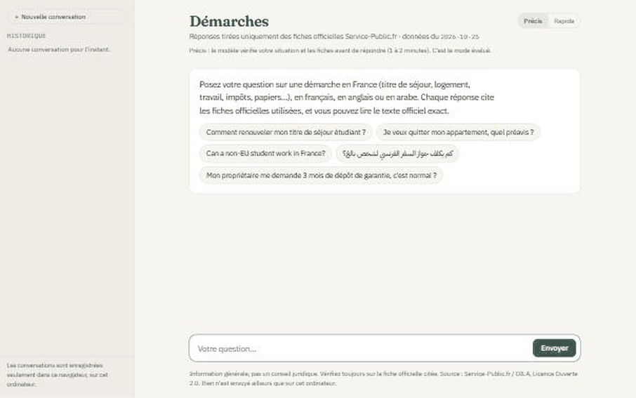

# Démarches FR: an assistant for French administrative procedures, with measured reliability

[](https://github.com/youssef-khazal/fr-admin-assistant/actions/workflows/tests.yml)  -informational) [](LICENSE)

Ask a question about a French administrative procedure (residence permit, housing benefit, driving licence exchange, change of address…) in French, English, SMS French, with typos, or in Arabic (experimental). The assistant answers **only from the official Service-Public.fr guides** and cites the pages it used.

When the guides don't answer the question, it says so. It then points to the right official page, office or phone number instead of guessing.

The project is about **measuring** how far such an assistant can be trusted. Retrieval and answers are scored on a test set of 163 questions written for this project (every expected fact copied from the official sheets), the LLM judge is checked against a reference grading, and the results include the failures.

Everything runs locally: a quantised 8B open model (Qwen3-8B through Ollama) on an 8 GB laptop GPU. No paid API is used.



*The real answers from a live test on the laptop (Qwen3-8B; careful mode, then fast mode for the last question), replayed in the chat UI with the waiting time cut: the real search and writing times are shown under each answer (the first one includes loading the models). Each answer cites the official sheets, and "Voir le texte officiel" opens the exact passage the answer used.*

## How it works

```
question ──► search ───────────────────────────► answer ────────────────────────► reply
             BM25 + bge-m3 embeddings (hybrid)     Qwen3-8B, JSON output:          text + cited official pages
             → cross-encoder reranker              answer / clarify / fallback /   + offices & phone numbers
             → 8 passages with their headings      off-topic / emergency / refuse  + situation buttons
```

1. **Data:** the official "vosdroits" XML export of Service-Public.fr (DILA, Licence Ouverte 2.0), which holds 3,004 guide sheets and 653 contact records. `scripts/build_corpus.py` turns the XML into clean text. It keeps the structure of the sheets: situations ("Vous êtes étudiant", "Vous êtes salarié"…), chapters, cases, online services and "Où s'adresser" contacts.
2. **Chunks keep their heading path** (sheet title > situation > chapter > case). This was the most useful single decision; see the results below.
3. **Search:** BM25 and bge-m3 dense vectors are fused (RRF), then the top 30 are reranked with bge-reranker-v2-m3.
4. **Answer:** the LLM gets the 8 passages, the contacts of the sheets they come from, and rules:
   - never state an amount, delay or condition that is not in the passages;
   - always cite;
   - answer in the user's language;
   - correct a false premise;
   - ask for the missing situation when the answer depends on it;
   - emergency numbers first.
   In "think" mode it first checks whether the passages really match the user's situation.
5. **App:** a FastAPI back end and a one-page chat UI. Cited pages show as links, along with their date. Situation buttons come from the official situation labels, and a contacts card appears when the assistant can't answer.

## Results

### Search (does the right official sheet come back?)
On 144 answerable questions, with a dev/test split; "hit@5" means the right sheet is in the top 5:

| method | hit@1 | hit@5 | MRR |
|---|---|---|---|
| BM25 only | 0.50 | 0.73 | 0.59 |
| bge-m3, chunks **without** headings | 0.55 | 0.86 | 0.69 |
| bge-m3, fixed 250-word windows | 0.65 | 0.86 | 0.75 |
| multilingual-e5-large, chunks with headings | 0.60 | 0.89 | 0.71 |
| bge-m3, chunks with headings | 0.76 | 0.93 | 0.84 |
| **hybrid + reranker (used)** | **0.78** | **0.96** | **0.86** |

- Adding the heading path to each chunk gives **+21 points of hit@1**.
- Rewriting the question with the LLM before searching was tested and **rejected**: it improved 15 questions and hurt 21. It sometimes changed the meaning (for example, "se pacser" became "se marier").

### Robustness to wording
People ask the same thing in many ways. 24 of the questions were each rewritten in 5 styles (formal, spoken, indirect description of the situation, bare keywords, misspelled), giving 120 variants (`data/eval/paraphrases.yaml`):

| style | hit@1 | hit@5 |
|---|---|---|
| formal | 0.75 | 1.00 |
| keywords | 0.88 | 1.00 |
| misspelled | 0.79 | 0.92 |
| spoken | 0.63 | 0.83 |
| indirect ("Je veux continuer mes études l'année prochaine mais mon titre se termine en septembre, comment je reste en règle ?") | 0.46 | 0.79 |
| **all 120** | **0.70** | **0.91** |

Search holds up well to typos, keywords and formal phrasing; it is weakest when the user describes a situation without naming the procedure. In a conversation, a separate LLM call decides whether a new message continues the previous question ("Et pour un meublé ?") or starts a new one; it is right on 26 of 28 test cases (`data/eval/followups.yaml`). A rule in code was added after the live test: a long message that shares no word with the previous one and does not start like a continuation ("et…", "c'est…") is treated as a new question without asking the LLM.

### Answers (judged against the expected facts of each question)
163 questions across 18 categories: clean, typos, SMS, English, Arabic, abbreviations, false premises, missing situation, follow-ups, questions not covered by the guides, off-topic, emergencies and prompt injection.

Each answer is graded on three things: did the assistant pick the **right behaviour** (answer, ask for the situation, fall back to official contacts, give emergency numbers first, refuse…), how many of the **expected facts** it gives, and whether it states **something invented or applied to the wrong situation**. Every answer of v4 to v7 received a reference grading (163 × 4): each answer read in full against its passages by a stronger model (Claude), with a note for every error. All versions were also graded by the LLM judge.

| version | what changed | right behaviour (ref.) | facts found (ref.) | invented or wrong (ref.) | behaviour / facts (judge) |
|---|---|---|---|---|---|
| v1 | first prompt | – | – | – | 72% / 67% |
| v2 | stricter rules (situation check, no invented figures) | – | – | – | 78% / 77% |
| v4 | + reasoning mode, answer-language control | 90.2% | 82.2% | **14.1%** | 87% / 83% |
| v5 | + follow-up detection, abbreviation glossary, multi-part search, passages from other situations, number check | 89.6% | 80.2% | 17.2% | 89% / 84% |
| v6 | v5 narrowed + safety guards in code | 91.4% | 80.6% | 18.4% | 85% / 83% |
| **v7 (final)** | v4's passages + v6's guards and glossary | **92.6%** | 81.4% | 15.3% | **89% / 87%** |
| v7 "Rapide" | v7 without the reasoning step | – | – | – | 82% / 80% |

"–" = no reference grading. The reference grading (163 answers per version) was done for the versions that were candidates for the final one, v4 to v7; the early versions v1 and v2 and the fast mode are compared with the LLM judge only. v3 was a short intermediate test and is not reported.

95% bootstrap intervals (2,000 resamples of the 163 questions) are about ±4 points for behaviour and facts and ±6 points for invented content. Paired differences, same questions resampled:

| | behaviour | facts | invented |
|---|---|---|---|
| v7 − v4 | +2.5 [−0.6, +5.5] | −0.8 [−3.9, +2.3] | +1.2 [−4.9, +7.4] |
| v7 − v6 | +1.2 [−1.2, +3.7] | +0.8 [−2.8, +4.8] | −3.1 [−8.0, +1.8] |

**What the versions show:**
- **Code guards help; extra context does not.** v5 and v6 gave the model more text (passages from other situations, split sub-questions). Each change fixed some answers and broke others, and invented content went up from 14% to 17–18%. With an 8B model, more passages mostly means more mixing of rules between neighbouring cases.
- **v7** goes back to v4's 8 passages (plus at most one passage for another situation, only when the question names none) and keeps everything that is enforced in code: emergency numbers first, a fixed off-topic reply, refusal of injected instructions, citations, a number check, follow-up detection and the abbreviation glossary. It has the best behaviour score (92.6%: every emergency, off-topic, injection, follow-up, false-premise and abbreviation question handled correctly) with invented content back near v4's level. Compared with v4, it fixes 5 behaviour failures and breaks 1. The differences with v4 are within the noise, so the honest summary is: **v7 is at least as good as v4 on facts, and better on safety behaviour.**
- **Rapide mode** (no reasoning step) is several times faster (about 25 s per answer on the laptop GPU), at a cost of about 7 points of behaviour and facts (judge figures). The UI offers both and says so.
- **Speed of the careful mode:** v7 was measured with a context of 12,288 tokens, which does not fit in the 8 GB GPU (part of the model ran on the CPU, about 4 minutes per answer). Re-run at 8,192 tokens, it runs fully on the GPU at about 70 s per answer, with the same scores within the noise (judge: behaviour −1.8 [−6.8, +3.1], facts −1.6 [−4.6, +1.6]). 8,192 is the default.

**Where v7 still goes wrong (reference grading):**
- *Rule mixing* is the main error: a rule from a neighbouring case given for the user's case. Examples: the 12-month family-reunification rule for Algerians extended to all of North and sub-Saharan Africa; the payment delay of another type of fine given for a speeding ticket; a rule for "regroupement sur place" given for the general case.
- *Search misses*: when the right sheet is not retrieved, the answer falls back or answers from a nearby sheet (e.g. a change of address for a residence card answered with the general change-of-address service).
- *Arabic* is the weakest language: 80% behaviour and 69% facts on 15 questions, against 92–100% in French and English, with some translation slips (EU/EEA rendered as an "African economic area").

**How far the judge can be trusted:** the judge is Qwen3-8B in reasoning mode, comparing each answer with its passages and the expected facts. Against the reference grading of the 163 v7 answers it agrees on 93% of behaviour verdicts and 90% of facts, but only 70% of invented-content verdicts (71–79% for earlier versions). It is good enough to compare versions on behaviour and facts, but not to count invented content, which is why that column comes from the reference grading. The judge tends to list *missing* facts as "unsupported"; `scripts/score_answers.py` corrects for this. In the reference grading, an answer that lists the possible cases instead of asking a question was accepted for "clarify" questions.

### Fine-tuning a smaller model (Qwen3-4B, QLoRA)
Qwen3-4B was fine-tuned with a LoRA add-on on 658 answers written by v7 itself, on questions generated from sheets that are **not** in the test set. Training took 3 hours on the laptop GPU. Same 163 questions, same search and checks:

| model | right behaviour | facts found | invented or wrong |
|---|---|---|---|
| Qwen3-4B, before fine-tuning (judge) | 73.6% | 72.3% | 32.5% |
| Qwen3-4B + LoRA (judge) | 79.8% | 78.7% | 30.1% |
| Qwen3-4B + LoRA (ref.) | 85.9% | 76.3% | 27.0% |
| v7, Qwen3-8B + reasoning (ref.) | 92.6% | 81.4% | 15.3% |

The fine-tuned model is clearly better than the 4B it started from: +6.3 [+1.2, +11.6] points of facts found. It also learned to say when the guides don't answer: it labels 9 of the 11 not-covered questions that way, against 1 before. It does not reach v7: it has nearly twice as much invented content, and Arabic answers are its weak point. So the app keeps v7. Method, the memory tricks needed to train on 8 GB, and detailed results: [`finetune/README.md`](finetune/README.md). The trained add-on is on Hugging Face: [youssef-khazal/qwen3-4b-demarches-lora](https://huggingface.co/youssef-khazal/qwen3-4b-demarches-lora).

## Honest limits
- When search misses the right sheet, the assistant can only fall back. About 4% of questions don't get the right sheet in the top 5. For Arabic questions this is 1 in 15.
- The test set is 163 questions. That is enough to compare versions, not to give a precise failure rate. Each per-category number rests on a handful of questions.
- The reference grading was done by a single grader, an LLM (Claude) reading every answer against its passages; a human second grader would make the invented-content figures more robust.
- The judge is itself an 8B model: reliable for behaviour and facts, not for invented content.
- The assistant gives general information from the official guides. It is not legal advice, and it does not replace the administration or an adviser.

## Run it
With Docker (app + Ollama; the corpus and index must be built first, see below):
```bash
docker compose -f docker-compose.yml -f docker-compose.gpu.yml up -d --build   # NVIDIA GPU; plain "docker compose up -d" runs on CPU
docker compose exec ollama ollama pull qwen3:8b                                 # first time only
# chat page on http://localhost:8000
```
Tested with Docker Desktop on Windows (WSL 2) and an 8 GB laptop GPU: the model runs 100% on the GPU, and a fast-mode answer takes about 5 s of search and 12 s of writing once the models are loaded (the first question also downloads the search models).
Or locally:
```bash
pip install -e .[app]
ollama pull qwen3:8b
# download the "vosdroits" export (see data/README) into data/raw/, then:
python scripts/build_corpus.py
python scripts/embed.py
uvicorn fr_admin_assistant.app:app --port 8000        # THINK=1 makes the careful mode the default
```
Unit tests (no model needed, run in CI): `pip install -e .[dev] && pytest`.

To reproduce the evaluation:
```bash
python scripts/eval_retrieval.py                 # search setups -> results/retrieval.json
python scripts/eval_search.py                    # final search on questions and rewordings
python scripts/eval_followup.py                  # follow-up detector
python scripts/run_answers.py --tag _v7 --think --judge-out judgements2_v7.jsonl   # answer + judge the 163 questions
python scripts/score_answers.py v7=results/judgements2_v7.jsonl --manual results/manual_grades_v7.jsonl
```
Every result file is described in [`results/README.md`](results/README.md). The fine-tuning experiment has its own steps in [`finetune/README.md`](finetune/README.md).

## Repository layout
```
src/fr_admin_assistant/
  parse.py, chunking.py   XML sheets -> clean text -> passages with their heading path
  retrieval.py            BM25, dense search, fusion
  pipeline.py             search + reranking, prompt, answer, checks and guards in code
  llm.py, judge.py        LLM client (Ollama, or a Hugging Face model + LoRA add-on); the LLM judge
  rewrite.py              LLM query rewriting (tested, rejected: see Search results)
  app.py, static/         FastAPI back end and the chat page
scripts/                  corpus building, embeddings, evaluation runs, scoring
finetune/                 fine-tuning Qwen3-4B with QLoRA: data generation, checks, training
data/eval/                the 163 test questions, 120 rewordings, 28 follow-up cases
results/                  every answer, judge verdict and reference grade behind the numbers above
tests/                    unit tests (no model needed), run on every push
```

## Data and licence
This project uses the data **"Fiches pratiques et ressources de Service-Public.gouv.fr Particuliers"** (DILA), file `vosdroits-latest.zip`, export of 25 October 2026, from [data.gouv.fr](https://www.data.gouv.fr/datasets/fiches-pratiques-et-ressources-de-service-public-gouv-fr-particuliers), under the **Licence Ouverte / Open Licence 2.0**. *Source : Service-Public.fr / DILA — mise à jour : 25/10/2026.* The text of the guides is not modified, only split into passages. Details in [`data/README.md`](data/README.md).

This is an independent project. It is not affiliated with or endorsed by the French administration.

Code: MIT licence (see `LICENSE`). Data: Licence Ouverte 2.0, DILA.
